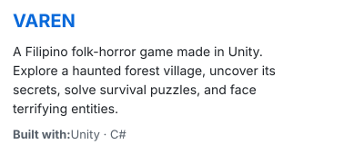
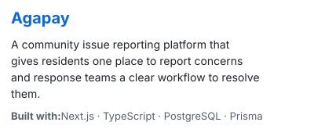
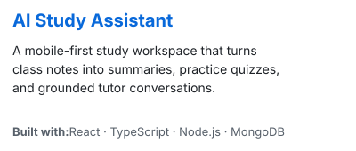
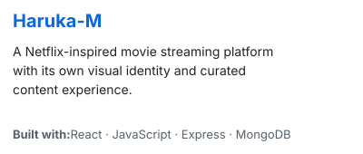
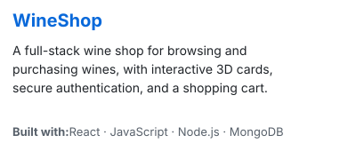
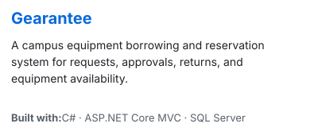

<div align="center">

# Hi, I'm Jan.


</div>

```text
                                                                     janninobansag
                                                                     ----------------------------------------------

                         ..    ........                              OS:                Windows 11, Android 12
                                     ..:.                            Born:              2004
               .                        ...
              .                             .                        Languages, Programming:
            ..                               .                           C#, C++, JavaScript, Python
           .                                 ...
          ..                                  ..                     Languages, Computer:
          ..                                   .                         HTML, CSS, SQL, JSON
          .                       ..           ..
           .                  .........        .                     Tools:
           .    .::.     ..-----:.::--::..    .                         Unity
           .:   :------:::::---:::.........                             Blender
           \---..----:::.::---==-::-:::::::: ..                          Visual Studio
           -==::--=---------===-:--:.::::-::::                          VS Code
           .--:-==============---------------.                          Git / GitHub
            .----==========-==-----====-----:                           SQL Server / SSMS
             .----=============----===-----:
               \:--========-----:-:-===----:                          Hobbies / Software:
               .:--========-------------::                             Blender Modelling
                .---===--::::::::------::.                             Exploring by making new projects
                 .:-------------:::---::.                              Game Development
                 .::---------------::::.
                 .:-::----====----:::.:.                             Other Activities:
                .----:::--------:::::::-.                              Sleeping
              ...=+----:::::::::.:::::==.:..
           .:...:=++--------:::::----===.  .:..                      Contacts:
      ...  ......=+++=-------------=++==.       .:..                 ----------------------------------------------
 ....     .......=+++++=---------=++++=-            .....            Email:             janninobansag@gmail.com
..        ........:+++++++=-----=+++++==.                ...         Facebook:          Jan Nino Andrie Bansag
        ...... ...=+++++++=====++++++==. .                           Instagram:         @jan_nandrie
            ......-+++++:...... :+++++:.....                         Discord:           janxxy
          ........-+++==:  ...  .-=++=..  .. ..
       ............+++++==  .. :==+===.. .... ..
        ...........=++++++=   .=+++=+-.   .
        ...........=++++++: .  -+++=+:.
            . .....:=+++==  ..  =++==:.
```

<div align="center">

[](https://jannino.vercel.app/)
[](mailto:janninobansag@gmail.com)

</div>

<h3 align="left">Contributions</h3>

<picture>
  <source media="(prefers-color-scheme: dark)" srcset="https://raw.githubusercontent.com/janninobansag/janninobansag/output/github-snake-dark.svg?v=2" />
  <source media="(prefers-color-scheme: light)" srcset="https://raw.githubusercontent.com/janninobansag/janninobansag/output/github-snake.svg?v=2" />
  
</picture>

<h3 align="left">Featured Projects</h3>

<p align="center">
  <a href="https://github.com/janninobansag/game"></a>
  &nbsp;&nbsp;
  <a href="https://github.com/janninobansag/Agapay"></a>
</p>

<p align="center">
  <a href="https://github.com/janninobansag/Ai-Assistant"></a>
  &nbsp;&nbsp;
  <a href="https://github.com/janninobansag/Haruka-M"></a>
</p>

<p align="center">
  <a href="https://github.com/janninobansag/WineShop"></a>
  &nbsp;&nbsp;
  <a href="https://github.com/janninobansag/Gearantee"></a>
</p>

<h3 align="left">GitHub Activity</h3>

<p>My contribution activity is shown in the snake animation above. You can also <a href="https://github.com/janninobansag?tab=repositories">browse all my public repositories</a>.</p>

<h3 align="left">Toolbox</h3>

<div align="center">
<picture>
  <source media="(prefers-color-scheme: dark)" srcset="https://raw.githubusercontent.com/janninobansag/janninobansag/staging/assets/toolbox-expanded-dark.gif" />
  <source media="(prefers-color-scheme: light)" srcset="https://raw.githubusercontent.com/janninobansag/janninobansag/staging/assets/toolbox-expanded-light.gif" />
  
</picture>
<p><sub>Also: SQL Server · JSON · ASP.NET Core · Entity Framework Core</sub></p>
</div>
